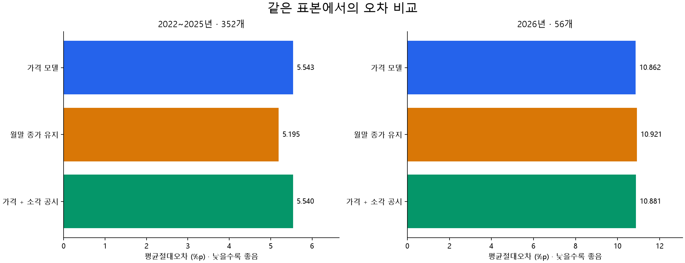

# CorpScope

CorpScope는 공공기관의 기업·재무 데이터를 수집·정제·저장하고 조회하는 백엔드 프로젝트다. 대량 적재와 재시작, 계정 표준화, 정정 보고서 관리, 과거 시점 조회를 구현하며 데이터 처리 경험을 쌓는 것을 목표로 한다.

OpenDART 재무정보와 KRX 가격 자료를 기반으로 분석과 예측 실험까지 진행했다. 현재 공개 저장소에는 Java 백엔드와 테스트, DB 마이그레이션, 기본 실행 스크립트를 담았다. 수집 원본, 인증정보와 DB 덤프는 포함하지 않는다. 월별 모델 실험 코드와 결과 그래프는 별도로 정리했다.

## 구조

```text
OpenDART → 원본 보존 → 계정 정제 → Spring Batch → PostgreSQL
                                                    ↓
                                               조회·재무 분석

공시목록·보고서 원문 → 버전별 검토 → 과거 기준일 조회
KRX 가격 → 임시 적재 → 기업행동·이용 가능 시점 검토
```

Java 21, Spring Boot 3.5.16, Gradle, PostgreSQL 16을 사용한다. 조회는 Spring Data JPA, 대량 쓰기는 JDBC batch로 처리한다. Spring Batch가 적재 실행과 재시작을 관리하고, Flyway가 스키마 변경 이력을 관리한다. 공시 원문 파싱에는 jsoup을 사용한다.

관련 업무 코드를 함께 읽을 수 있도록 기능별 패키지로 구성했다.

| 패키지 | 역할 |
| --- | --- |
| company, disclosure | 기업·공시 저장과 조회 |
| external | 외부 API 클라이언트와 응답 DTO |
| financial | 재무 계정 정제와 보고서 버전 조회 |
| ingestion, batch | 원본 보존과 일괄 적재 |
| analysis | 재무 지표 계산 |
| market, dataset | 가격 적재와 데이터 준비 상태 점검 |
| operations | 로컬 운영 명령 |
| common | 공통 예외와 페이지 응답 |

## 데이터 처리

기업, 재무 계정, 공시는 각각 `company`, `financial_fact`, `disclosure`로 분리한다. `raw_ingestion`에 원본 응답을 보존해 정제 규칙을 바꾼 뒤 다시 검토할 수 있도록 했다. 기업 코드와 접수번호는 문자열로 저장하고, 금액에는 BigDecimal을 사용한다. 누락값은 0으로 바꾸지 않는다.

Batch는 제한된 chunk 단위로 처리하며 실행 이력과 재시작 위치를 DB에 남긴다. UNIQUE 제약과 트랜잭션으로 중복·부분 적재를 방지한다. 일시적 외부 장애는 재시도하고, 인증 오류와 정제 오류는 실패로 남긴다.

보고서 공개 목록과 검토 버전을 분리해 나중에 정정된 수치가 과거 입력에 섞이지 않도록 했다. 기준일에 이용 가능한 최신 보고서가 미검토이면 이전 승인본으로 대체하지 않고 보류 사유를 반환한다. 연결·별도 재무제표, 분기 당기·누적 금액과 비교 기간도 구분한다.

스키마는 `src/main/resources/db/migration`에서 확인할 수 있다. Hibernate는 `validate`를 사용하며, 적용한 Flyway 파일을 수정하는 대신 새 마이그레이션을 추가한다. 인덱스와 추가 최적화는 실제 쿼리의 `EXPLAIN (ANALYZE, BUFFERS)`를 근거로 판단한다.

## 실행

Java 21과 Docker Desktop이 필요하다. `JAVA_HOME`을 Java 21 설치 폴더로 설정한 뒤 PowerShell에서 실행한다. 기존 `.env`가 있다면 복사 단계를 건너뛴다.

```powershell
Copy-Item .env.example .env
# .env의 DB_PASSWORD를 로컬 비밀번호로 변경
# 실제 OpenDART 수집에는 OPENDART_API_KEY 입력

docker compose up -d --wait
. ./scripts/Load-LocalEnv.ps1
./gradlew.bat build
./gradlew.bat bootRun
```

DB 연결은 `DB_NAME`, `DB_USERNAME`, `DB_PASSWORD`, `DB_PORT`로 설정하며 필요하면 `DB_URL`을 지정한다. Spring은 `.env`를 자동으로 읽지 않으므로 실행할 PowerShell에서 환경 로더를 먼저 호출한다. 실제 키는 저장소에 포함하지 않는다. KRX 키와 서비스 승인은 OpenDART와 별개다.

서버 주소는 `http://127.0.0.1:8080`이다. API 키 없이 서버를 기동하고 가상 데이터를 적재할 수 있다.

```powershell
./scripts/Import-Financials.ps1 -Demo -FiscalYear 2024 -RequestId demo-2024-1

# 실제 삼성전자 수집
./scripts/Import-Financials.ps1 -CorpCodes 00126380 -FiscalYear 2024 -ReportType ANNUAL -RequestId samsung-2024-1

./scripts/Get-BatchStatus.ps1
```

실패한 Job은 같은 식별 파라미터로 재시작한다. 완료한 Job을 재수집할 때는 새 `RequestId`를 사용한다. 보고서 유형은 `Q1`, `HALF_YEAR`, `Q3`, `ANNUAL`, 연결·별도 구분은 `CFS`, `OFS`다. 자동 Job 실행과 스케줄은 기본 비활성화 상태다.

## API

기업 검색으로 DB 내부 id를 확인한 뒤 조회한다. 이 id는 OpenDART 기업 코드와 다르다.

```text
GET /actuator/health
GET /api/companies/search?name=삼성
GET /api/companies/{id}
GET /api/companies/{id}/financials?fiscalYear=2024&reportType=ANNUAL&statementType=CFS
GET /api/companies/{id}/disclosures
GET /api/companies/{id}/analysis?fiscalYear=2024&reportType=ANNUAL&statementType=CFS
```

응답에는 Entity 대신 DTO를 사용한다. 목록은 `page`, `size`로 조회하며 페이지 크기는 최대 100이다. 매출 성장률, 영업이익률, 부채비율, ROA·ROE는 조회와 계산을 분리하고 분모와 비교 기준을 검사한다. 과거 기준일 조회는 해당 기간의 검토 자료가 저장되어 있어야 사용할 수 있다.

## 테스트

JUnit 5와 Mockito로 계산·변환·예외 처리를 검사한다. PostgreSQL 통합 테스트에는 Testcontainers를 사용해 중복 적재, rollback, Batch 재시작과 보고서 버전 선택을 확인한다.

```powershell
./gradlew.bat test
./gradlew.bat integrationTest
```

통합 테스트에는 실행 중인 Docker 엔진이 필요하다. 성능 측정은 기본 build와 분리되어 있다. 테스트 성공이 모든 기업의 회계 기준 검토나 실제 API 연동 성공을 뜻하지는 않는다.

## 예측 실험

로컬 연구에서는 8개 기업의 가격 자료로 다음 달 일별 종가 평균을 예측했다. 최근값 유지, 선형회귀, LightGBM을 같은 표본과 시간 경계에서 비교하고, 소각 공시 추가와 혼합 예측, 검증 기간 확대를 실험했다.

2022~2025년 352개 기업·월 표본에서 평균절대오차는 전월 평균 유지 6.436%p, 가격 모델 5.543%p, 월말 종가 유지 5.195%p였다. 초기 기준선은 개선했지만 월말 종가 유지보다 안정적으로 좋은 모델은 확보하지 못했다. 이미 관찰한 과거 기간을 이용한 회고적 실험이며 최종 미래 성능으로 해석하지 않는다.

[실험 설명](docs/forecast-experiments-portfolio.md) · [코드와 실행 방법](docs/experiments.md) · [기업별 그래프](docs/figures/2026.png)



전처리·시간 분할·기준선·모델 비교 코드와 테스트를 포함했다. 전체 재학습에는 별도 원본 자료가 필요하다. 생성형 AI 호출도 구현하지 않았다. 향후 LLM은 검증된 예측값과 분석 결과를 설명하는 역할로 사용할 계획이다.

## 한계와 다음 단계

공개 코드에 포함한 원문 발췌와 검토 규칙은 특정 기업·기간에 한정된다. 가상 데이터는 실제 기업의 실적이 아니며, 가격 임시 적재가 학습 승인을 의미하지도 않는다. 과거 API의 정확한 게시시각과 모든 기업행동을 복원한 상태는 아니다.

다음에는 수집 범위와 계정 매핑을 확대하고, 대량 적재 처리량과 재시작 비용을 측정한다. 조회 성능은 실제 데이터 규모에서 검증한다. 모델 실험은 공개한 평가 근거를 바탕으로 오차가 반복되는 조건을 살펴볼 계획이다. 외부 서비스 배포 전에는 인증과 접근제어를 추가해야 한다.

## 출처

기업·재무 자료는 [OpenDART](https://opendart.fss.or.kr/), 가격 자료는 [KRX OPEN API](https://openapi.krx.co.kr/)를 사용한다. 원천 자료는 각 제공기관의 이용 조건을 따른다.

Spring Batch 메타데이터 DDL은 [PostgreSQL schema (Apache 2.0)](https://github.com/spring-projects/spring-batch/blob/v5.2.6/spring-batch-core/src/main/resources/org/springframework/batch/core/schema-postgresql.sql)를 기반으로 한다.
